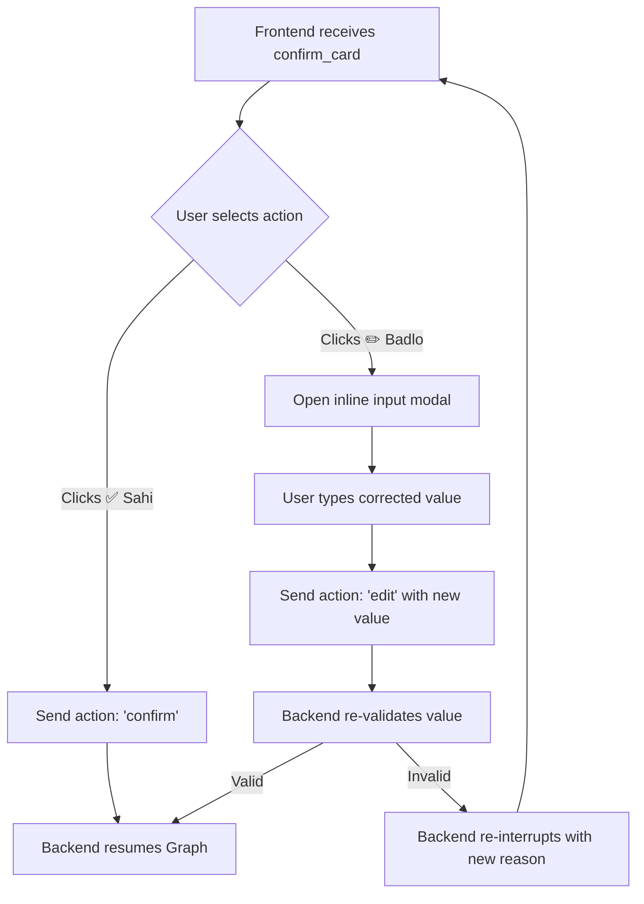

# ComplianceOS — VEDA Frontend Handoff Specification

> **Documentation Only** — For the Frontend Engineering team (`complyos-frontend/`). Do not modify backend code from this document.

---

## 1. OutboundMessage Shapes Emitted by VEDA

All communication from VEDA is delivered through the channel-neutral `OutboundMessage` schema. VEDA emits four message types: `text`, `option_card`, `confirm_card`, and `file`.

### 1.1 `text`
Simple markdown-formatted notification, summary, or alert.
```json
{
  "type": "text",
  "text": "✅ GST Registration Certificate verify ho gaya hai.\n\n• GSTIN: 09AAECP1234F1ZP\n• Business: SHARMA ENTERPRISES PRIVATE LIMITED\n• State: Uttar Pradesh\n• Health Score: 95/100\n\nYeh jaankari sirf samajhne ke liye hai, professional salaah nahi."
}
```

### 1.2 `option_card`
Presents selectable action chips or routing choices (e.g. document type disambiguation or post-verification next actions).
```json
{
  "type": "option_card",
  "title": "Document Type Select",
  "text": "Yeh kis tarah ka document hai? Kripya chunein:",
  "options": [
    { "id": "GST_CERTIFICATE", "label": "GST Registration Certificate (REG-06)" },
    { "id": "UDYAM_CERTIFICATE", "label": "Udyam Registration Certificate" },
    { "id": "GST_NOTICE", "label": "GST Notice / Demand (DRC-01, ASMT-10)" },
    { "id": "CHALLAN_ACK", "label": "GST Challan / Filing Ack (PMT-06)" },
    { "id": "LICENCE_INVOICE", "label": "Licence or Tax Invoice" }
  ]
}
```

Post-verification next steps card:
```json
{
  "type": "option_card",
  "title": "Next Actions",
  "options": [
    { "id": "share_ca", "label": "🤝 CA ko share karein", "value": { "action": "share_ca", "docId": "doc_123" } },
    { "id": "view_calendar", "label": "📅 Compliance Calendar dekhein", "value": { "action": "view_calendar" } }
  ]
}
```

### 1.3 `confirm_card`
Human-in-the-loop review card for fields where LLM confidence was `< 0.80`, deterministic validators raised a discrepancy, or document data conflicted with a self-reported profile value.
```json
{
  "type": "confirm_card",
  "title": "Verification Needed",
  "text": "Kripya in details ko verify karein:\nYeh jaankari sirf samajhne ke liye hai, professional salaah nahi.",
  "card": {
    "type": "confirm_card",
    "disclaimer": "Yeh jaankari sirf samajhne ke liye hai, professional salaah nahi.",
    "items": [
      {
        "key": "gstin",
        "label": "GSTIN (GST Number)",
        "value": "09AAECP1234F1Z9",
        "evidenceQuote": "Registration Number: 09AAECP1234F1Z9",
        "reasons": [
          "GSTIN checksum mismatch: expected \"P\" at position 15, got \"9\""
        ],
        "buttons": [
          { "id": "confirm_gstin", "action": "confirm", "label": "✅ Sahi" },
          { "id": "edit_gstin", "action": "edit", "label": "✏️ Badlo" }
        ]
      }
    ]
  }
}
```

### 1.4 `file`
Used when VEDA shares generated compliance exports, CA audit packs, or receipt images.
```json
{
  "type": "file",
  "title": "Compliance Audit Summary",
  "fileUrl": "https://res.cloudinary.com/complyos/raw/upload/v1/reports/audit_doc_123.pdf",
  "mimeType": "application/pdf"
}
```

---

## 2. Sample Payloads per VEDA Status

### 2.1 Status: `OK`
Document processed, validated, and committed to profile, calendar, and health score.
```json
{
  "status": "OK",
  "profilePatch": {
    "gstin": {
      "value": "09AAECP1234F1ZP",
      "status": "VERIFIED",
      "confidence": 0.98,
      "source": "veda_doc",
      "evidence": {
        "docId": "doc_123",
        "quote": "Registration Number: 09AAECP1234F1ZP"
      },
      "updatedAt": "2026-09-30T10:00:00.000Z"
    },
    "state": {
      "value": "Uttar Pradesh",
      "status": "VERIFIED",
      "confidence": 0.96,
      "source": "veda_doc",
      "evidence": {
        "docId": "doc_123",
        "quote": "Lucknow, Uttar Pradesh"
      },
      "updatedAt": "2026-09-30T10:00:00.000Z"
    }
  },
  "messages": [
    {
      "type": "text",
      "text": "✅ GST Registration Certificate verify ho gaya hai.\n\n• GSTIN: 09AAECP1234F1ZP\n• Business: SHARMA ENTERPRISES PRIVATE LIMITED\n• Health Score: 95/100\n\nYeh jaankari sirf samajhne ke liye hai, professional salaah nahi."
    }
  ],
  "claims": [
    {
      "text": "Verified fields extracted from GST CERTIFICATE",
      "sourceUrl": "https://services.gst.gov.in/services/searchtp",
      "lastVerified": "2026-09-30",
      "basis": "document",
      "confidence": 0.95
    }
  ],
  "calendarItems": [
    {
      "id": "statutory-gstr-1",
      "title": "GSTR-1 (Outward Supplies)",
      "deadlineDate": "2026-11-11",
      "urgency": "high",
      "category": "GST",
      "sourceUrl": "https://gst.gov.in"
    }
  ],
  "trace": [],
  "costs": { "llmTokens": 250, "tinyfishAgentCalls": 0 }
}
```

### 2.2 Status: `NEEDS_INPUT` (Photo Unclear / Retake Tips)
Triggered when OCR text is empty or shorter than 15 characters.
```json
{
  "status": "NEEDS_INPUT",
  "profilePatch": {},
  "messages": [
    {
      "type": "text",
      "text": "Photo clear nahi hai, dobara bhejein.\n\nTips:\n• Achhi roshni mein photo lein (shadow na ho)\n• Document ko seedha aur flat rakhein\n• Poora panna dikhna chahiye, chaaron kone cover ho\n\nYeh jaankari sirf samajhne ke liye hai, professional salaah nahi."
    }
  ],
  "claims": [],
  "calendarItems": [],
  "trace": [],
  "costs": { "llmTokens": 0, "tinyfishAgentCalls": 0 }
}
```

### 2.3 Status: `NEEDS_CONFIRMATION`
Triggered by confidence `< 0.80`, validator failure, or self-reported conflict. Graph pauses and emits `confirm_card`.
```json
{
  "status": "NEEDS_CONFIRMATION",
  "profilePatch": {},
  "messages": [
    {
      "type": "confirm_card",
      "title": "Verification Needed",
      "text": "Kripya in details ko verify karein:\nYeh jaankari sirf samajhne ke liye hai, professional salaah nahi.",
      "card": {
        "type": "confirm_card",
        "disclaimer": "Yeh jaankari sirf samajhne ke liye hai, professional salaah nahi.",
        "items": [
          {
            "key": "district",
            "label": "District",
            "value": "Lucknow",
            "evidenceQuote": "Lucknow, Uttar Pradesh",
            "reasons": [
              "Aapne Kanpur bataya tha, GST certificate mein Lucknow hai. Kaunsa sahi hai?"
            ],
            "buttons": [
              { "id": "confirm_district", "action": "confirm", "label": "✅ Sahi" },
              { "id": "edit_district", "action": "edit", "label": "✏️ Badlo" }
            ]
          }
        ]
      }
    }
  ],
  "claims": [],
  "calendarItems": [],
  "trace": [],
  "costs": { "llmTokens": 210, "tinyfishAgentCalls": 0 }
}
```

### 2.4 Status: `DEGRADED`
Triggered when Groq times out or reaches rate limit, or unsupported file format is uploaded.
```json
{
  "status": "DEGRADED",
  "profilePatch": {},
  "messages": [
    {
      "type": "text",
      "text": "Abhi document padhne mein dikkat hai, thodi der baad try karein."
    }
  ],
  "claims": [],
  "calendarItems": [],
  "trace": [],
  "costs": { "llmTokens": 0, "tinyfishAgentCalls": 0 }
}
```

### 2.5 Status: `FAILED`
Triggered on unexpected server errors. User is never left without feedback.
```json
{
  "status": "FAILED",
  "profilePatch": {},
  "messages": [
    {
      "type": "text",
      "text": "Kuch takneeki kharabi aayi hai. Kripya thodi der baad dubara koshish karein."
    }
  ],
  "claims": [],
  "calendarItems": [],
  "trace": [],
  "costs": { "llmTokens": 0, "tinyfishAgentCalls": 0 }
}
```

---

## 3. `confirm_card` Payload Structure & Edit Flow

### Payload Specification
- **`key`**: Canonical field identifier (`gstin`, `pan`, `udyamNumber`, `district`, `replyDueDate`, `amountDemanded`, etc.).
- **`label`**: Human-readable field title in UI.
- **`value`**: Extracted or candidate value.
- **`evidenceQuote`**: Verbatim substring directly quoted from the document.
- **`reasons`**: Array of human-readable warnings explaining why confirmation is required.
- **`buttons`**:
  - `confirm`: User accepts the candidate value.
  - `edit`: User provides a corrected value.

### User Interaction & Edit Flow


---

## 4. Resuming Graph Interrupts (`CONFIRM_ACTION` & `askDocType`)

When resuming from an interrupt, the client sends a `resume` payload.

### 4.1 Confirm Action Resume
When user clicks "✅ Sahi":
```json
{
  "runId": "run_1728555000",
  "event": {
    "action": "CONFIRM_ACTION",
    "payload": {
      "key": "gstin",
      "action": "confirm"
    }
  }
}
```

### 4.2 Edit Action Resume
When user enters an edit:
```json
{
  "runId": "run_1728555000",
  "event": {
    "action": "CONFIRM_ACTION",
    "payload": {
      "key": "gstin",
      "action": "edit",
      "value": "09AAECP1234F1ZP"
    }
  }
}
```

### 4.3 `askDocType` Option Card Resume
When user picks a document type for an unclassified upload:
```json
{
  "runId": "run_1728555000",
  "event": {
    "action": "resume",
    "payload": {
      "docType": "GST_CERTIFICATE"
    }
  }
}
```

---

## 5. Claims, Calendar, Penalty, and Health Score Data Shapes

### 5.1 Claims
Every user-facing fact carries `sourceUrl`, `lastVerified`, and an official statutory basis.
```json
{
  "text": "Notice tax demand of ₹57,600 under Section 73",
  "sourceUrl": "https://calcguru.in/gst-late-fee-interest-fy-2026-27-guide",
  "lastVerified": "2026-09-30",
  "basis": "code_rule",
  "confidence": 1.0
}
```

### 5.2 Calendar Items
```json
{
  "id": "notice-reply-doc_123",
  "title": "Reply to GST Notice (Show Cause Notice)",
  "deadlineDate": "2025-02-10",
  "urgency": "high",
  "category": "GST Notice",
  "description": "Section 73 notice response deadline",
  "sourceUrl": "https://gst.gov.in"
}
```

### 5.3 Health Score Breakdown
The score is deterministic between 0 and 100 based on completeness and overdue liabilities.
```json
{
  "healthScore": 85,
  "reasons": [
    "GSTIN verified (+10)",
    "PAN verified (+5)",
    "1 upcoming high-urgency notice reply (-10)"
  ]
}
```

---

## 6. TraceEvent Specification for Frontend Trace Panel

VEDA records execution events into the `trace[]` array at each node:
```json
{
  "runId": "run_1728555000",
  "agent": "VEDA",
  "node": "ocr",
  "startedAt": "2026-09-30T10:00:01.120Z",
  "durationMs": 142,
  "inputSummary": "{\"url\":\"https://res.cloudinary.com/...\"}",
  "outputSummary": "{\"textLength\":842,\"confidence\":0.94}",
  "status": "done"
}
```

### Standard VEDA Node Sequence
1. `intake`
2. `ocr`
3. `mask`
4. `classify` (or `askDocType` if unknown)
5. `extract`
6. `evidenceCheck`
7. `validate`
8. `gate`
9. `confirm` (if flagged)
10. `commit`
11. `respond`

---

## 7. Document Upload Contract

- **Accepted MIME Types**: `image/jpeg`, `image/png`, `image/webp`, `application/pdf`.
- **Max File Size**: 10 MB.
- **Initial Event Shape**:
```json
{
  "runId": "run_uuid_v4",
  "userId": "usr_uuid_v4",
  "event": {
    "type": "DOCUMENT",
    "docId": "doc_cloudinary_public_id",
    "url": "https://res.cloudinary.com/complyos/image/upload/v1/...",
    "mime": "image/jpeg"
  },
  "profile": {},
  "locale": "hinglish"
}
```

---

## 8. Open Architecture Questions for Backend Lead `[VERIFY]`

1. **`[VERIFY]` Document Upload Endpoint**:
   - Confirm whether the frontend uploads directly to `/api/documents/upload` via `multer` + Cloudinary, and passes the resulting Cloudinary URL into the agent run event.
2. **`[VERIFY]` Resume / Confirm Endpoint**:
   - Is resume triggered via `POST /api/documents/:id/confirm` or through the WebSocket channel `ariaSocket.js`?
3. **`[VERIFY]` Thread Persistence & Checkpointer**:
   - Confirm the Postgres checkpointer instance used by the parent orchestrator to persist interrupted state across multi-turn user edits.
